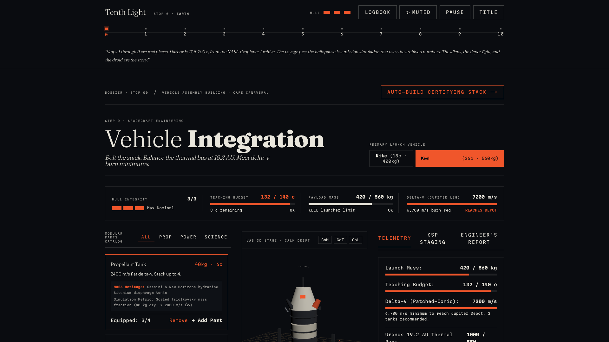
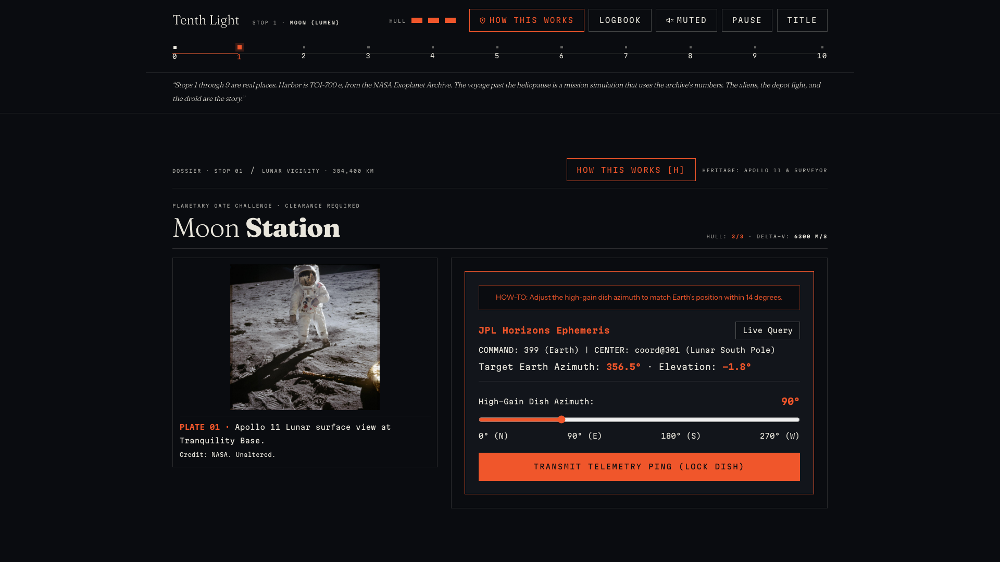

<h1 align="center">The Tenth Light</h1>

<p align="center">
  
  <br />
  <strong>A space mission design game for the NASA Space Apps Challenge 2026</strong>
  <br />
  <em>"Design the ship. Stay in the seat. Send the droid."</em>
</p>

<p align="center">
  <a href="https://tenth-light.vercel.app"><strong>Play Live on Vercel</strong></a> &nbsp;&bull;&nbsp;
  <a href="https://www.spaceappschallenge.org/2026/find-a-team/hubble-horizons/?tab=project"><strong>Space Apps Submission</strong></a> &nbsp;&bull;&nbsp;
  <a href="https://1drv.ms/p/c/5d6c8f0368f48b28/IQAK4XN06IYmS6RtsfYhzG--AeyV_eGfnFNZQRdago5KvD0?e=pgJLsE"><strong>Demo Deck (OneDrive)</strong></a> &nbsp;&bull;&nbsp;
  <a href="https://tenth-light.vercel.app/data"><strong>NASA Data Disclosures</strong></a> &nbsp;&bull;&nbsp;
  <a href="docs/"><strong>Documentation &amp; Reports</strong></a>
</p>

---

## What this is

Tenth Light is a web-based space mission design game built for the 2026 NASA Space Apps Challenge (*Space Mission Design Game*).

You play as flight specialist Wren, sealed inside the command capsule of an exploratory vessel heading out from Earth orbit to TOI-700 e, a terrestrial exoplanet 101.5 light-years away in the constellation Dorado. You never leave your seat. You configure the vehicle in an orbital assembly bay, balance mass against delta-V, manage power through the outer Solar System, and deploy an autonomous surface droid named Nori down to the regolith to collect candidate biosignature samples.

The project grounds its choices in actual aerospace constraints:

- If your launch vehicle can only loft 400 kg to orbit, you cannot carry both a deep-core drill and a mass spectrometer. You have to pick one.
- If you skip a radioisotope generator, the inverse-square law cuts your solar power down to 3.7 W/m² past the asteroid belt, freezing your avionics.
- Every transit stop connects directly to NASA open data: live orbital parameters from the NASA Exoplanet Archive, topocentric ephemerides from JPL Horizons, and historical reconnaissance photography from Apollo, Cassini, Dawn, Voyager, and New Horizons.

---

## Systems engineering & gameplay loop

### 1. Vehicle Assembly Bay (VAB)

<p align="center">
  
  <br/>
  <em>Figure 1: Vehicle Assembly Bay — configuring launcher capacity, structural mass fractions, and propulsion in real-time 3D.</em>
</p>

Before launch, you configure the spacecraft across four interlocked engineering budgets:

- **Launcher class & payload mass:** Sized against structural limits. The light Kite launcher costs 18 credits with a 400 kg limit. The heavy Keel launcher costs 36 credits and lifts up to 560 kg, leaving less budget for secondary propellant tanks.
- **Delta-V ($\Delta v$):** Sized with patched-conic approximation. Each auxiliary propellant tank adds 2,400 m/s of vacuum $\Delta v$. Reaching the heliopause gate requires 7,200 m/s minimum, plus an orbital refueling rendezvous at the Jupiter Depot.
- **Power curves & inverse-square law:** Solar irradiance falls off as $1/r^2$. At Uranus (19.2 AU), solar flux drops from 1,361 W/m² at Earth to 3.7 W/m², leaving standard photovoltaic panels with just 0.43 W per array. Running life support, heaters, and communications requires an RTG (Radioisotope Thermoelectric Generator).
- **Science suite:** A mass spectrometer confirms isotopic water ratios; a core drill extracts subsurface regolith. At mission debrief, the Directorate grades your return based on which instruments survived the voyage.

### 2. The Solar System expedition route

<p align="center">
  
  <br/>
  <em>Figure 2: Moon Station — aligning the high-gain dish using live topocentric azimuth and elevation calculated via the NASA JPL Horizons API.</em>
</p>

The outbound route steps through ten distinct stages, each paired with a systems challenge and NASA/JPL telemetry:

| Stop | Location | Focus | Integrated NASA / Space Agency Resource |
| :--- | :--- | :--- | :--- |
| **00** | Earth Orbit / VAB | Vehicle configuration | Systems Engineering Handbook mass fractions |
| **01** | Moon (Lumen) | High-gain dish alignment | **JPL Horizons Ephemeris API** (live topocentric Az/El from `coord@301`) |
| **02** | Mars (Redline) | Orbital capture mass cap | Mars Global Surveyor MOC wide-angle imagery (`PIA04304`) |
| **03** | Ceres (Pebble) | Asteroid belt navigation | **JPL Small-Body Database** (connectivity verification) + Dawn Ceres benchmarks |
| **04** | Jupiter Depot (Bolt) | Orbital propellant transfer | Cassini true-color Jupiter imagery (`PIA02873`) & kinetic interception |
| **05** | Enceladus (Spray) | Plume detection | Cassini imaging of south polar cryovolcanic water geysers (`PIA07758`) |
| **06** | Uranus (Tilt) | Breaker load triage | Voyager 2 true-color encounter imagery (`PIA18182`) & $1/r^2$ power shedding |
| **07** | Neptune (Lag) | Radio latency | Voyager 2 Great Dark Spot (`PIA01492`) & 4.17-hour light-speed delay |
| **08** | Pluto (Heart) | Cryo-geomorphology | New Horizons high-res color mosaic of Tombaugh Regio (`PIA19952`) |
| **09** | Heliopause (Whisper) | Telemetry packet queues | Voyager 1 termination shock data & departure gate (`PIA17046`) |
| **10** | Harbor (TOI-700 e) | Autonomous surface sampling | **NASA Exoplanet Archive** (live TAP transit parameters) & Droid Nori |

---

## Scientific disclosures

Tenth Light keeps a clear line between verified astrophysics and speculative narrative:

> *"Stops 1 through 9 are real places. Harbor is TOI-700 e, from the NASA Exoplanet Archive. The voyage past the heliopause is a mission simulation that uses the archive's numbers. The aliens, the depot fight, and the droid are the story."*

- **The interstellar cruise:** TOI-700 e is 101.5 light-years away (31.13 parsecs). Traveling at 0.1c (~30,000 km/s) takes roughly 1,015 years in Earth's reference frame. While radiation-pressure sails (JAXA IKAROS, NASA ACS3) and ion drives (Dawn, Deep Space 1) are flight-proven, macroscopic travel at 0.1c remains theoretical.
- **Surface conditions:** NASA TESS transit photometry gives us TOI-700 e's 27.81-day orbital period, 0.919 Earth radius, and position in the optimistic habitable zone. No existing telescope has detected an atmosphere, surface water, or magnetic field there. The canisters retrieved by Droid Nori in Act 10 are designated as candidate biosignature simulants.
- **Complete disclosures dossier:** Available in-game at [`/data`](https://tenth-light.vercel.app/data).

---

## Technical architecture

- **Framework:** Next.js 16.4.6 (App Router), React 19.3.0, TypeScript 5
- **Styling:** Tailwind CSS v4 with custom CSS variables (no bloated component libraries)
- **3D Graphics:** Three.js 0.187.0 rendering procedural spacecraft meshes, gantry frames, and lighting in the VAB. **Zero external 3D models** (`.gltf`, `.glb`, or `.obj`) are downloaded.
- **Procedural Audio:** 100% synthesized in real time via the browser's native Web Audio API (55 Hz / 110 Hz cabin drone, filtered white-noise thrusters, and bandpass telemetry chirps). **Zero external audio files** (`.wav`, `.mp3`) are loaded.
- **Micro-Interactions:** Morphicons 2.0.2 for spring-physics directional indicators; Canvas-Confetti 1.9.4 on mission completion.
- **APIs & Live Endpoints:**
  - NASA Exoplanet Archive (synchronous Table Access Protocol via `pscomppars`)
  - JPL Horizons Ephemeris REST API (rolling 24-hour UTC window)
  - NASA Near Earth Object Web Service (NeoWs API)
  - NASA DSCOVR EPIC API (daily natural-color Earth disc imagery)
  - NASA Image and Video Library API (reconnaissance photograph gateway)
  - JPL Small-Body Database API (endpoint connectivity verification)
- **Fallback Snapshots:** If external network latency exceeds 2,500 ms, endpoints automatically fall back to dated archival snapshots (`lib/nasaSnapshots.ts`, captured 15 November 2026).
- **State & Storage:** Clean client-side state with `localStorage` persistence (`tenth-light-v1`). No tracking cookies, external analytics, or accounts required.
- **Automated QA:** Comprehensive Playwright test suite (18/18 passing tests) covering full mission progression, Horizons date calculations, and trade-off mechanics.

---

## Project identity & logo

The project insignia and favicon represent **Astromech Droid Nori**, Wren's loyal robotic flight companion. Designed on a strict 16x16 pixel grid using the project's terminal palette (deep void `#0a0c10`, signal orange `#f0562b`, and paper cream `#e9e6dc`).

- Master vector logo: [`public/nori-logo.svg`](public/nori-logo.svg)
- Style guide and token rules: [`docs/assets/STYLE_GUIDE.md`](docs/assets/STYLE_GUIDE.md)
- UI and typographic guidelines: [`DESIGN.md`](DESIGN.md)

---

## Documentation & submission dossier

All technical documentation, audited NASA data citations, and authentic gameplay captures are compiled in the [`docs/`](docs/) directory:

- **Official Space Apps Entry:** [Hubble Horizons Project Page](https://www.spaceappschallenge.org/2026/find-a-team/hubble-horizons/?tab=project)
- **Project Demonstration Deck:** [OneDrive Presentation (7 Slides)](https://1drv.ms/p/c/5d6c8f0368f48b28/IQAK4XN06IYmS6RtsfYhzG--AeyV_eGfnFNZQRdago5KvD0?e=pgJLsE)
- **Gameplay Screenshots:** 13 authentic 1920×1080 captures in [`docs/screenshots/`](docs/screenshots/) (see [`README.md`](docs/screenshots/README.md) for educational captions)
- **Audited Reports & Dossiers:**
  - [`nasa-data.md`](docs/nasa-data.md): Complete list of NASA datasets, APIs, and consumed fields
  - [`other-resources.md`](docs/other-resources.md): External software stack, typography, and partner mission citations
  - [`asset-license-audit.md`](docs/asset-license-audit.md): Individual NASA image plate audit and copyright breakdown
  - [`submission-report.md`](docs/submission-report.md): Master technical dossier and submission record
  - [`PROJECT_SUMMARY_AND_FACTS.md`](docs/PROJECT_SUMMARY_AND_FACTS.md): Concise physics breakdown, learning objectives, and disclosures
  - [`video-voiceover-script.md`](docs/video-voiceover-script.md): 30-second timed voiceover and scene guide

### AI-Use Disclosure

In accordance with competition rules, AI tools (Google DeepMind Antigravity, Claude, Gemini) were utilized for:
1. **Research & Information Gathering:** Cross-referencing NASA TAP API schema, JPL Horizons endpoint parameters, and planetary distances.
2. **Coding, Debugging & Troubleshooting:** Refactoring TypeScript components, procedural Three.js rendering, and writing Playwright integration tests.
3. **Presentation & Documentation:** Structuring slides, formatting markdown tables, and synthesizing the technical dossier.

All gameplay rules, astrodynamic models, systems trade-offs, and narrative writing were verified and approved by the human project team.

---

## Running locally

Requirements: Node.js 20+ and npm.

```bash
# Clone the repository
git clone https://github.com/sharmao07/tenth-light.git
cd tenth-light

# Install dependencies
npm install

# Start development server
npm run dev
```

Open [http://localhost:3000](http://localhost:3000) in your browser.

To run the automated Playwright test suite:

```bash
# Run all 18 end-to-end tests
npm run test
```

---

## License & credits

- **Source Code:** Open source under the [MIT License](LICENSE).
- **Astronaut Photography:** Apollo 11 (`as11-40-5903`) and Apollo 17 (`as17-148-22727`) photography by NASA civil servant astronauts are works of the United States Government in the public domain under 17 U.S.C. § 105.
- **Planetary Mission Imagery:** Plates from Cassini, Dawn, Mars Global Surveyor, Voyager, and New Horizons were produced by NASA centers, research universities, and contractor institutions (including JPL-Caltech, Malin Space Science Systems, UCLA/MPS/DLR, Space Science Institute, and JHUAPL/SwRI). These are reproduced for non-commercial educational purposes with scientific attribution in accordance with NASA Media Usage Guidelines; contractor and third-party copyright remains held by their respective institutions and is not claimed as public domain.
- **Typefaces:** Fraunces, Instrument Sans, and Martian Mono are licensed under the SIL Open Font License 1.1.
